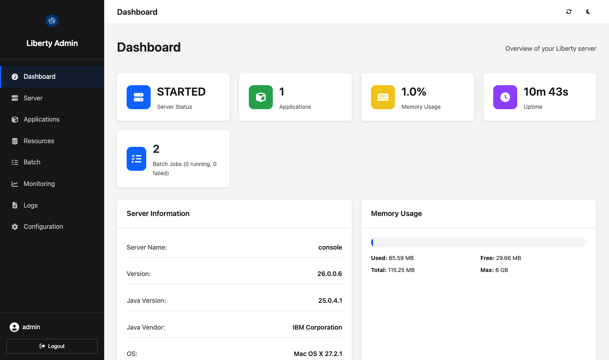
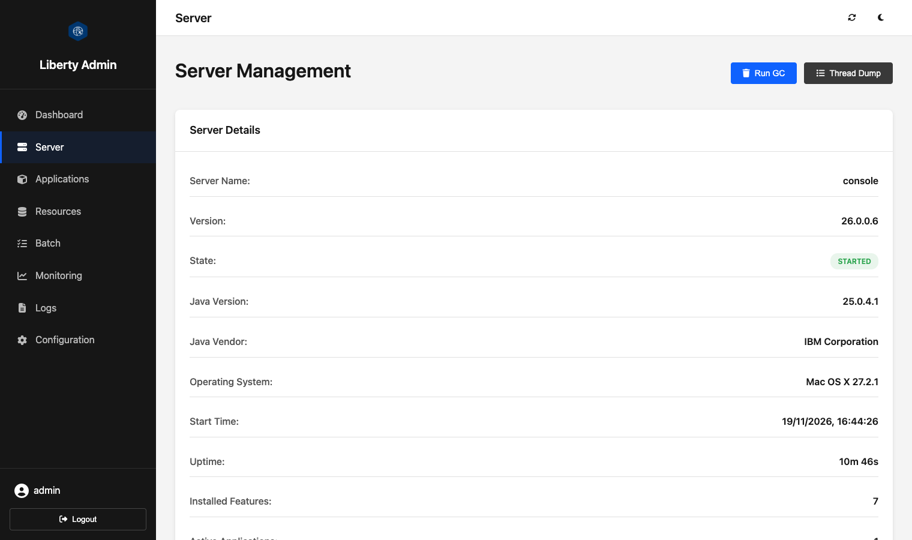
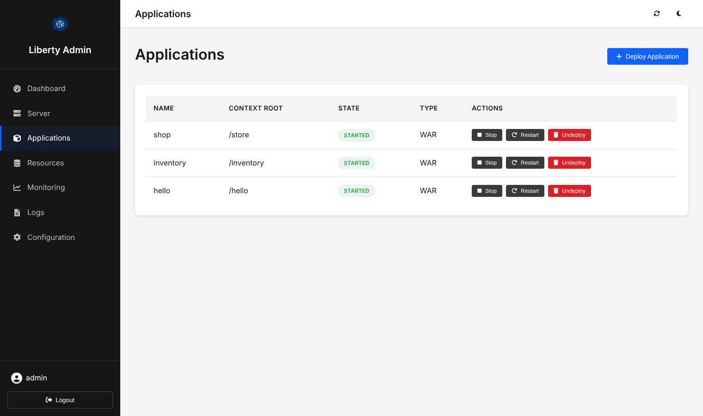
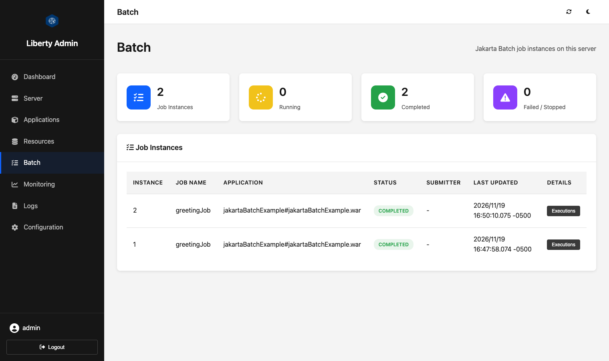
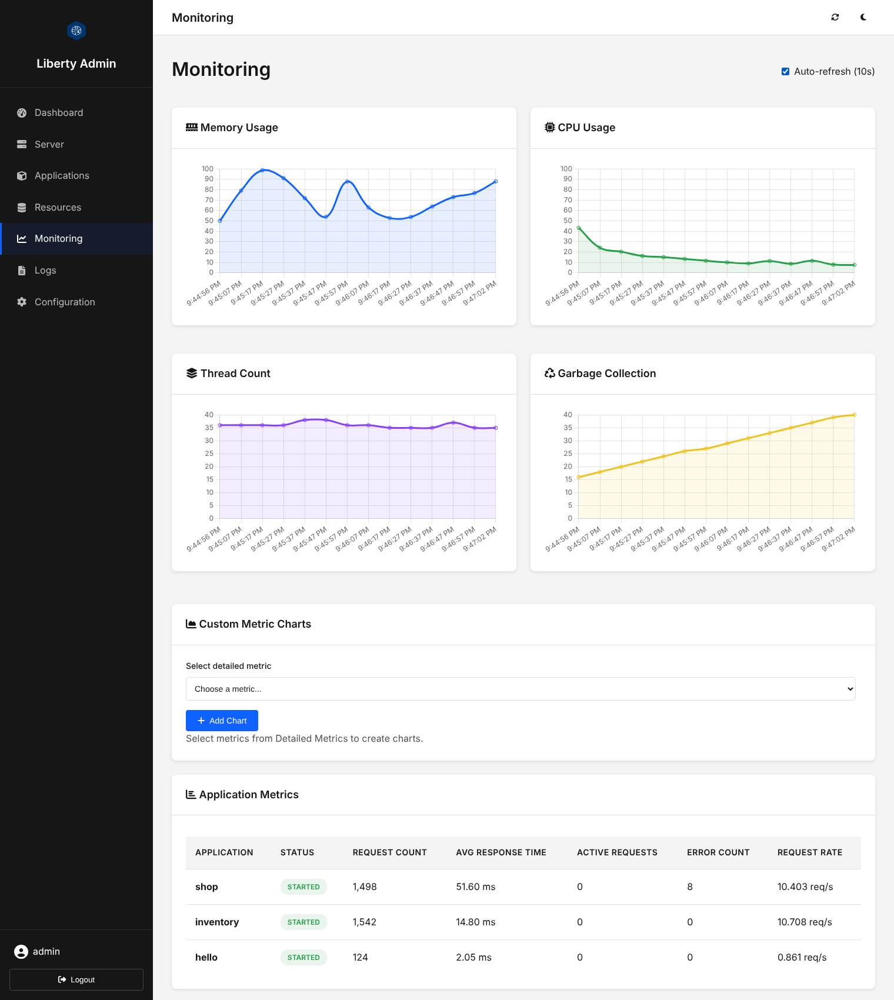
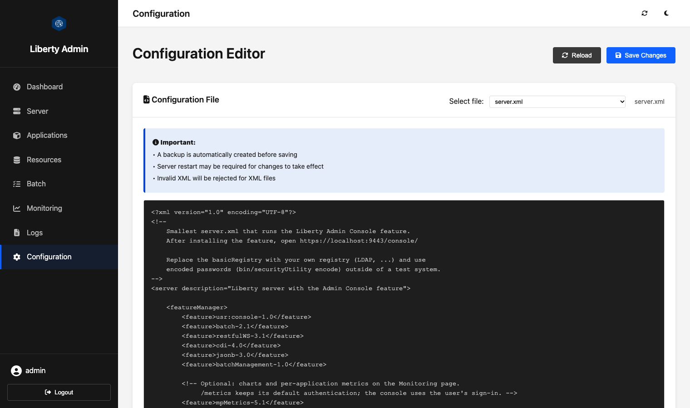

# Liberty Admin Console — Liberty feature (`usr:console-1.0`)

A web console for monitoring and administering a Liberty server, delivered as a **Liberty user
feature**. Install the feature, add it to `server.xml`, and the console comes up at
`https://<host>:9443/console/` on any Liberty server:

```xml
<featureManager>
    <feature>usr:console-1.0</feature>
</featureManager>
```

It has a dashboard, server and JVM details, application management (start, stop, upload,
remove), resources, batch jobs, monitoring, logs and a configuration editor. The console is an OSGi
**Web Application Bundle (WAB)** inside the feature, built the same way as Liberty's own Admin Center:

* Users sign in with the server's `<administrator-role>` (full access) and `<reader-role>` (read-only).
* The feature enables the Liberty features it needs; nothing else has to be added to `server.xml`.
* The context path is `/console` by default and can be changed with `<usr_console contextPath="..."/>`.
* Applications are started, stopped and restarted through Liberty's `ApplicationMBean`.

## Screenshots

Taken on a running Liberty 26.0.0.6 server (Java 25) with the `jakartaBatchExample`
application deployed and `mpMetrics-5.1` enabled.

**Dashboard**: server status, applications, memory, uptime and batch jobs at a glance.



**Server**: server details, with Run GC and Thread Dump actions.



**Applications**: every application on the server, with start, stop, restart and undeploy.



**Batch**: Jakarta Batch job instances with their status and executions.



**Monitoring**: memory, CPU, thread and garbage-collection charts refreshed every 10 seconds,
and per-application request metrics.



**Configuration**: edit `server.xml` and other configuration files in the browser. A backup is
created before every save.



## Quick start

1. **Build** (or use the prebuilt files in `dist/`):

   ```bash
   mvn clean package
   ```

2. **Install the feature** into your Liberty installation:

   ```bash
   /opt/ibm/wlp/bin/featureUtility installFeature console-feature/target/console-1.0.esa
   # or: scripts/install-feature.sh /opt/ibm/wlp
   ```

3. **Add it to server.xml**, together with users and roles ([`samples/server.xml`](samples/server.xml) has a complete example):

   ```xml
   <featureManager>
       <feature>usr:console-1.0</feature>
   </featureManager>

   <basicRegistry id="basic" realm="BasicRealm">
       <user name="admin" password="change-me"/>
   </basicRegistry>
   <administrator-role><user>admin</user></administrator-role>

   <keyStore id="defaultKeyStore" password="${keystore_password}"/>
   ```

4. **Start the server** and open **https://localhost:9443/console/**. Accept the self-signed
   certificate, then sign in.

5. *(Optional)* Check the installation from the command line:

   ```bash
   python3 scripts/smoke-test.py --url https://localhost:9443/console --admin admin:change-me --insecure
   ```

The rest of this file covers each step in detail.

## Requirements

* Open Liberty or WebSphere Liberty with Servlet 3.0 through 6.1
  (`servlet-3.0`, `servlet-3.1`, `servlet-4.0`, `servlet-5.0`, `servlet-6.0` or `servlet-6.1`).
  The console selects the Java EE (`javax.servlet`) or Jakarta EE (`jakarta.servlet`)
  adapter automatically. Servlet 3.0 is available in WebSphere Liberty; Open Liberty starts at 3.1.
  With no servlet feature already selected, the console enables Servlet 6.0.
* Java 17 or later to run the server
* Maven 3.8+ and JDK 17+ to build

Tested on Open Liberty 26.0.0.9 (Java 21): installed with featureUtility, the zip and the script, on servers with
`servlet-5.0`, `servlet-6.0`, `servlet-6.1`, `appSecurity-5.0` + `restfulWS-3.1` + `cdi-4.0`,
and `jakartaee-10.0` + `adminCenter-1.0`.
WebSphere Liberty has the same SPIs but wasn't part of that testing.

The Servlet compatibility update was also tested on Open Liberty 26.0.0.9 (Java 21)
with `servlet-3.1`, `servlet-4.0`, `servlet-5.0`, `servlet-6.0`, `servlet-6.1`,
and the default configuration. Checks cover login, read-only APIs, reader-role restrictions,
application uploads, and loading exactly one console WAB. The Java EE adapter and its tests
compile against the Servlet 3.0 API; running on WebSphere Liberty with `servlet-3.0`
remains to be verified.

## Build

```bash
mvn clean package
```

| Output | What it is |
|---|---|
| `console-feature/target/console-1.0.esa` | Feature archive for `featureUtility` / `installUtility` |
| `console-feature/target/console-1.0-usr-extension.zip` | The same feature as files under `wlp/usr/extension/` |
| `console-bundle/target/com.ibm.liberty.admin.console_1.0.0.jar` | Jakarta WAB (Servlet 5.0–6.1) |
| `console-bundle-javax/target/com.ibm.liberty.admin.console.javax_1.0.0.jar` | Java EE WAB (Servlet 3.0–4.0) |

`mvn install` also puts the ESA in your local Maven repository
(`com.ibm.liberty.admin:console-feature:1.0.0:esa`).

`dist/` has a prebuilt copy of the ESA and the zip, so you can install without
building first. Rebuild and replace them when you change the code.

## Install

Use **one** of these. They all install the same five files:

```
wlp/usr/extension/lib/com.ibm.liberty.admin.console_1.0.0.jar
wlp/usr/extension/lib/com.ibm.liberty.admin.console.javax_1.0.0.jar
wlp/usr/extension/lib/features/com.ibm.liberty.admin.console-1.0.mf
wlp/usr/extension/lib/features/com.ibm.liberty.admin.console-1.0.javax.mf
wlp/usr/extension/lib/features/com.ibm.liberty.admin.console-1.0.jakarta.mf
```

**featureUtility** (Open Liberty and WebSphere Liberty):

```bash
wlp/bin/featureUtility installFeature console-feature/target/console-1.0.esa
```

On WebSphere Liberty, `wlp/bin/installUtility install console-1.0.esa` should take the same file (not tested here).

**Zip**: extract it in the directory that *contains* `wlp/`:

```bash
unzip console-feature/target/console-1.0-usr-extension.zip -d /opt/ibm      # gives /opt/ibm/wlp/usr/extension/...
```

**Script**: copies the files from the build output (or from `dist/` if you haven't built) into
`$WLP_USER_DIR`, or `<wlp>/usr` when that variable isn't set:

```bash
scripts/install-feature.sh /opt/ibm/wlp
```

To uninstall, stop the server and delete the five files. When upgrading with
`featureUtility`, remove the previous console files first: it does not reinstall an
already installed feature with the same version. The script and zip replace them directly.

## Configure

Smallest working configuration (also in [`samples/server.xml`](samples/server.xml)):

```xml
<server>
    <featureManager>
        <feature>usr:console-1.0</feature>
    </featureManager>

    <basicRegistry id="basic" realm="BasicRealm">
        <user name="admin" password="change-me"/>
        <user name="operator" password="change-me-too"/>
    </basicRegistry>

    <administrator-role><user>admin</user></administrator-role>   <!-- full access -->
    <reader-role><user>operator</user></reader-role>              <!-- read-only -->

    <keyStore id="defaultKeyStore" password="${keystore_password}"/>
    <httpEndpoint id="defaultHttpEndpoint" host="*" httpPort="9080" httpsPort="9443"/>
</server>
```

Then open **https://localhost:9443/console/**. Plain HTTP redirects to HTTPS.

Any Liberty user registry works (`basicRegistry`, `ldapRegistry-3.0`, ...), and
`<administrator-role>` / `<reader-role>` accept `<user>`, `<group>`, `<user-access-id>` and
`<group-access-id>`. They are the same roles Admin Center and the REST connector use.
Signed-in users without either role get HTTP 403. The feature ships no users or passwords.

### Optional settings: `<usr_console>`

```xml
<usr_console contextPath="/console"/>
```

| Attribute | Default | Meaning |
|---|---|---|
| `contextPath` | `/console` | Where the console is served. You can change it while the server runs; Liberty moves the console to the new path. |

### Monitoring and metrics (optional)

Enable MicroProfile Metrics to fill the Monitoring page:

```xml
<feature>mpMetrics-5.1</feature>
```

`/metrics` keeps its default authentication; you don't need `<mpMetrics authentication="false"/>`:

* **Charts and JVM metrics**: the browser reads `/metrics` with your console sign-in. The `/metrics`
  endpoint accepts the same session and the same `<administrator-role>` / `<reader-role>` users.
* **Per-application table** (requests, average response time, errors, request rate): the console
  reads Liberty's monitoring MBeans (`HttpServerStats`, or `ServletStats` on older Liberty versions)
  inside the server, without an HTTP call. These come from `monitor-1.0`, which mpMetrics enables.
  Add `<feature>monitor-1.0</feature>` on its own if you want the table without mpMetrics.

Without either feature, everything else works: the Monitoring page explains that MicroProfile
Metrics isn't enabled, and the table shows zeros.

### Batch (optional)

**Batch functionality requires Servlet 3.1 or later and is not available with Servlet 3.0.**

The **Batch** page and the **Batch Jobs** card on the dashboard are always shown. Enable
Jakarta Batch and its management REST API to fill them with job instances (status, application,
submitter, last update) and the executions and steps of each one:

```xml
<feature>batch-2.1</feature>
<feature>batchManagement-1.0</feature>
```

The browser reads `/ibm/api/batch/jobinstances` with your console sign-in (tested with an
`<administrator-role>` user). Without the features the page and the card say that batch
management isn't enabled. The page asks for up to 200 job instances.

## Roles

| Operation | Administrator | Reader |
|---|:---:|:---:|
| Dashboard, server info, memory, health, thread pools, metrics | ✓ | ✓ |
| List applications | ✓ | ✓ |
| Read server.xml and other configuration files, read logs | ✓ | ✓ |
| Save UI settings (theme, charts) | ✓ | ✓ |
| Thread dump, garbage collection | ✓ | 403 |
| Start / stop / restart / deploy / upload / undeploy applications | ✓ | 403 |
| Edit server.xml and other configuration files | ✓ | 403 |

The sidebar shows the signed-in user's name, with "(read-only)" for readers. When a reader
tries something they aren't allowed to do, the UI shows the server's error message.

## What the console manages

* **Applications**: the list combines the applications in server.xml (`webApplication`,
  `enterpriseApplication`, `springBootApplication`, `application`), the ones Liberty installed
  from `dropins/`, and the ones uploaded through the console. Their state comes from Liberty.
  Uploads go to `${server.config.dir}/apps` and are added to server.xml. Undeploy removes the
  application from server.xml, waits for Liberty to uninstall it, then deletes the file.
  For dropins applications it deletes the file from `dropins/`.
* **Configuration**: server.xml is checked before it's saved: it must be well-formed, with a
  `<server>` root, and DTDs and external entities are rejected. The configuration editor lists
  and writes only configuration file types (`.xml`, `.properties`, `.env`, `.options`, `.json`, ...)
  in the server configuration directory. It skips `workarea/`, `logs/`, `apps/` and `dropins/`,
  and won't follow symbolic links out of the directory. Every save keeps a timestamped backup
  next to the file.
* **Logs**: any `*.log` file in the server's log directory, read from the end of the file
  (up to 100,000 lines).

## REST API

Paths are relative to the context path (default `/console`).

| Method | Path | Notes |
|---|---|---|
| GET | `/api/user` | Signed-in user and roles |
| GET | `/api/server/info`, `/memory`, `/health`, `/threadpools`, `/metrics/applications` | |
| GET | `/api/server/threads` | text/plain, Administrator |
| POST | `/api/server/gc` | Administrator |
| GET | `/api/applications`, `/api/applications/{name}` | |
| POST | `/api/applications/{name}/start` \| `stop` \| `restart` | Administrator |
| POST | `/api/applications/upload` | multipart: `file`, `name`, `contextRoot`, `type` (Administrator, up to 1 GB) |
| POST | `/api/applications` | JSON `{name, contextRoot, type}` (Administrator) |
| DELETE | `/api/applications/{name}` | removes it from server.xml and deletes the file (Administrator) |
| GET / PUT | `/api/configuration/server.xml` | text/plain; PUT needs Administrator, checks the XML and keeps a backup |
| GET | `/api/configuration/info`, `/api/configuration/files` | |
| GET / PUT | `/api/configuration/file?path=<relative path>` | files in the server config directory; PUT needs Administrator |
| GET | `/api/logs/messages?lines=N`, `/console`, `/list`, `/info`, `/file/{name}` | |
| GET / PUT | `/api/settings` | UI settings, stored in `${server.config.dir}/admin-console-settings.json` |

Errors come back as JSON: `{"error": "..."}`.

Scripts sign in through the login form and keep the session cookie. HTTP Basic is not accepted:

```bash
C=https://localhost:9443/console
curl -sk -c cookies -b cookies -o /dev/null "$C/"
curl -sk -c cookies -b cookies -o /dev/null -d 'j_username=admin&j_password=change-me' "$C/j_security_check"
curl -sk -b cookies "$C/api/server/info"
```

`scripts/smoke-test.py` runs these checks against a live server without changing anything:

```bash
python3 scripts/smoke-test.py --url https://localhost:9443/console \
    --admin admin:change-me --reader operator:change-me-too --insecure
```

## Project layout

```
pom.xml                              parent: versions, plugins
console-bundle/                      the Web Application Bundle
  bnd.bnd                            OSGi headers (Web-ContextPath, IBM-Authorization-Roles, imports)
  src/main/java/com/ibm/liberty/admin/
    internal/ConsoleConfiguration    DS component: <usr_console> config, WABConfiguration service
    internal/ConsoleRuntime          server locations (config dir, logs, ...) and settings
    json/Json                        small JSON writer/parser (no jsonb/jsonp needed)
    model/                           data returned by the REST API
    service/                         server, application, configuration, log, settings services
    web/                             REST API servlets (/api/server, /api/applications, ..., /api/user)
  src/main/resources/OSGI-INF/       metatype for <usr_console>
  src/main/webapp/                   UI (index.html, js, css) and WEB-INF/web.xml
console-bundle-javax/                generates the Java EE WAB and tests from console-bundle sources
  bnd.bnd                            Servlet 3.0–4.0 imports (Liberty OSGi package versions 2.6–2.8)
console-feature/
  src/main/feature/console-1.0.mf    public feature, servlet toleration and packaged adapter files
  src/main/feature/console-1.0.*.mf private auto-features selecting the Java EE or Jakarta WAB
  pom.xml                            builds the ESA and the usr-extension zip
dist/                                prebuilt console-1.0.esa and console-1.0-usr-extension.zip
docs/images/                         screenshots used in this README
samples/server.xml                   example configuration
scripts/install-feature.sh           installs into a Liberty directory
scripts/smoke-test.py                read-only checks against a running server
```

## How it works

* **Feature manifest**: `console-1.0.mf` defines `usr:console-1.0` (`IBM-ShortName`). Its content is the
  adapter files and these features:
  * `com.ibm.websphere.appserver.servlet-6.0`, which also accepts 3.0, 3.1, 4.0, 5.0 and 6.1
  * `com.ibm.wsspi.appserver.webBundle-1.0` and `webBundleSecurity-1.0`, the SPI features for WABs
    in product extensions
  * `com.ibm.websphere.appserver.restHandler-1.0`, which turns on the management security the WAB is authorized against
  * `transportSecurity-1.0`, for HTTPS
* **Servlet adapters**: private auto-features use `IBM-Provision-Capability` to load only the
  WAB for the selected servlet namespace: Java EE for 3.0/3.1/4.0, Jakarta for 5.0/6.0/6.1.
  The build generates Java EE sources and a Servlet 3.0 deployment descriptor from the Jakarta
  sources, so both adapters share the same implementation and test suite. Uploads read the
  `Content-Disposition` header through Servlet 3.0 APIs. The public feature packages both
  bundles and the auto-feature manifests as file resources so the ESA installs everything.
* **WAB**: the active bundle has `Web-ContextPath: @libertyAdminConsole`. The `@` means the path is
  configurable. `ConsoleConfiguration` is a DS component bound to the `<usr_console>` configuration.
  It registers a `WABConfiguration` service that tells Liberty the actual path. Liberty serves the
  web content (`index.html`, `js/`, `css/`, `WEB-INF/web.xml`) from the bundle.
* **Security**: `IBM-Authorization-Roles: com.ibm.ws.management` makes Liberty check the `web.xml`
  roles `Administrator` and `Reader` against `<administrator-role>` / `<reader-role>`, the same way
  Admin Center does. `web.xml` requires one of the two roles, FORM login, and HTTPS for everything
  apart from the login page. Servlets also check `Administrator` for operations that change the
  server, and they refuse those operations when the browser's `Origin` header names another site
  (cross-site request forgery protection).
* **Plain servlets, no CDI or JSON-B**: a WAB can't use the application programming model
  (CDI, JAX-RS annotation scanning), and depending on those features would push them, and an EE
  level, onto every server that enables the console. The REST API is therefore a set of servlets,
  the services are wired by a `ServletContextListener`, and JSON is handled by a small internal class.
* **Server information** comes from Liberty itself: server name and version from `ServerInfoMBean`,
  locations from the framework properties (`server.config.dir`, `server.output.dir`, log directory),
  and application state, start, stop and restart from `ApplicationMBean`.

## Troubleshooting

| Symptom | Cause / fix |
|---|---|
| `CWWKF0001E: A feature definition could not be found for usr:console-1.0` | Not installed, or installed under a different `WLP_USER_DIR`. Check `usr/extension/lib/features/`. |
| A servlet singleton conflict, or no console on a Java EE server | Rebuild and reinstall the complete feature, including both WABs and all three feature manifests. Older console packages only supported Servlet 5.0–6.1. |
| Login page keeps coming back, or 403 after signing in | The user isn't in `<administrator-role>` or `<reader-role>`. |
| `https://...:9443` doesn't answer | There's no HTTPS port: set `httpsPort` and a keystore (see above). |
| Monitoring page says MicroProfile Metrics is not enabled | Add `mpMetrics-5.1`. The per-application table only needs `monitor-1.0`. |
| Batch page says batch management is not enabled | Add `batch-2.1` and `batchManagement-1.0`. |
| Monitoring page says `/metrics` refused your sign-in | The user isn't in `<administrator-role>` or `<reader-role>`, or the session expired: sign in again. |
| Icons or charts missing | The UI loads Font Awesome and Chart.js from public CDNs (cdnjs, jsdelivr). The browser needs internet access. |

Enabling the feature also activates Liberty's REST handler framework at `/ibm/api/`. It is secured
by the same management roles, as it is with Admin Center.

See [SECURITY.md](SECURITY.md) for the security model and production recommendations.
